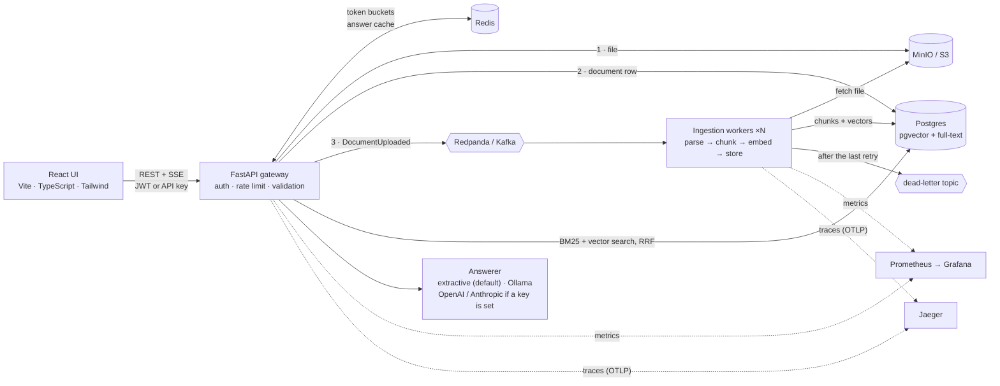
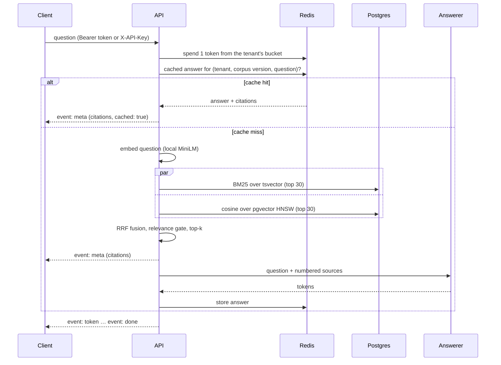
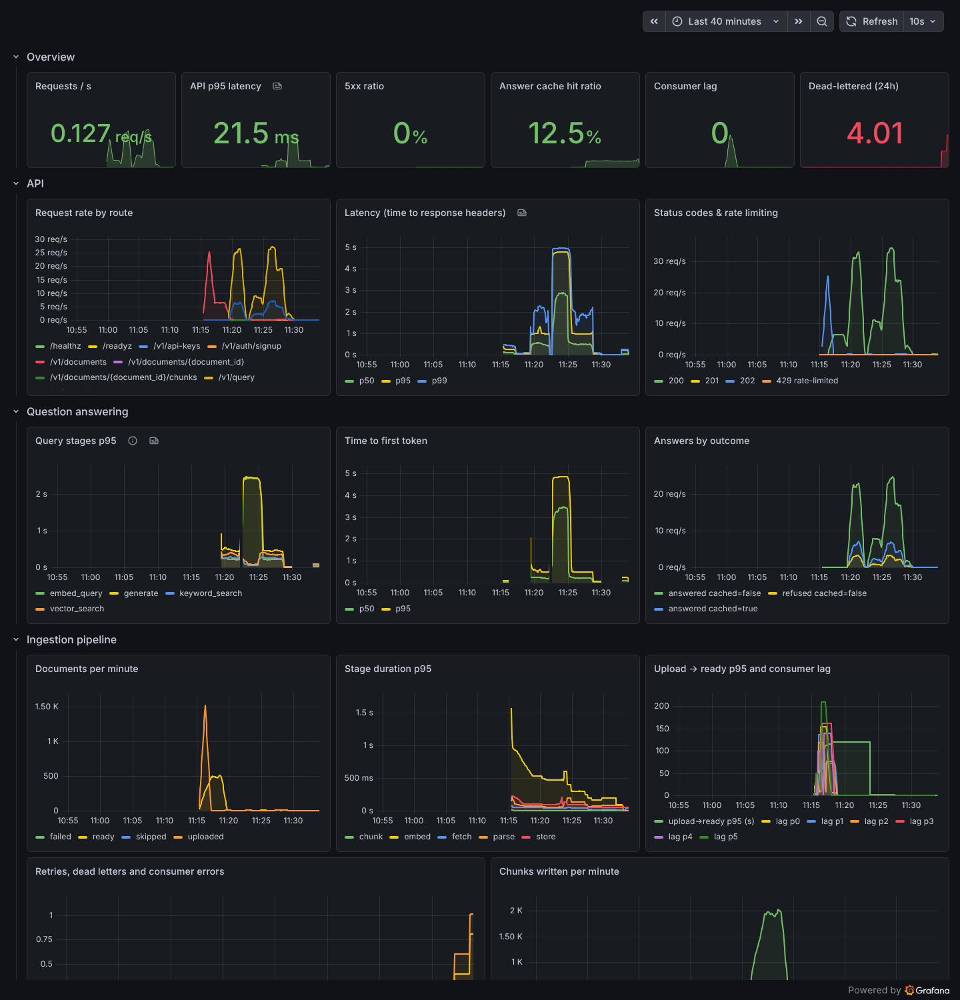
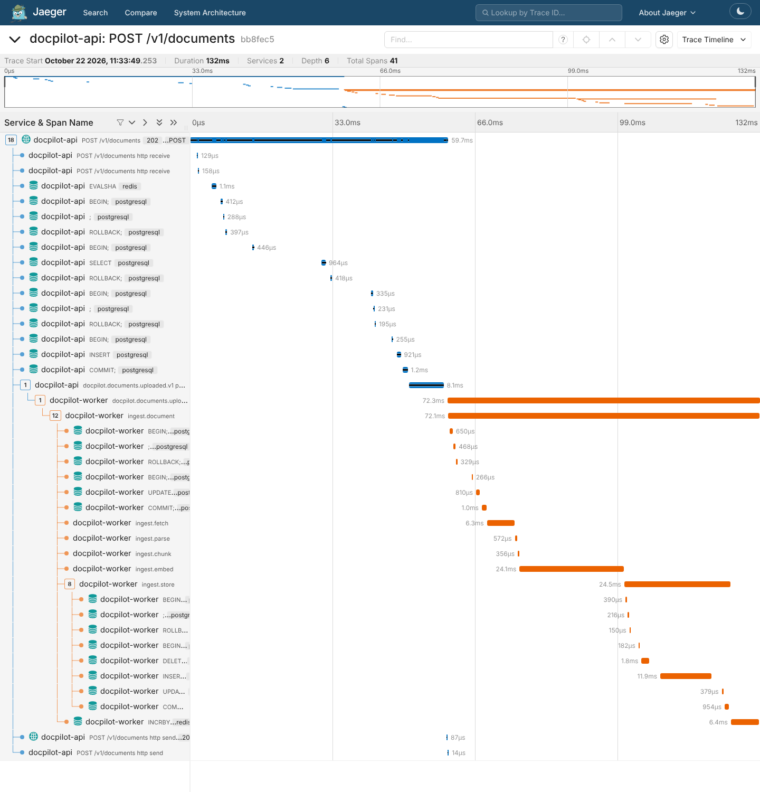

# DocPilot

[](https://github.com/sunag-kp/docpilot/actions/workflows/ci.yml)
[](https://github.com/sunag-kp/docpilot/actions/workflows/eval.yml)
[](https://sunag-kp.github.io/docpilot/)

[](LICENSE)

**Multi-tenant document Q&A. Upload PDF, DOCX or Markdown files, ask questions, and get streamed answers that cite the exact passages they came from. It says "I don't know" when the documents don't contain the answer.**

It runs entirely on free, local components: no accounts, no API keys, no paid services. Embeddings come from a local ONNX model, and the default answerer is built in. Ollama, OpenAI and Anthropic are optional.

**Live demo: [sunag-kp.github.io/docpilot](https://sunag-kp.github.io/docpilot/)** · **API reference: [sunag-kp.github.io/docpilot/api](https://sunag-kp.github.io/docpilot/api/)** · run the real stack with `make up`

> The GitHub Pages demo runs a simplified backend *inside your browser*: BM25 search and a lexical version of the extractive answerer over eight preloaded sample documents. It shows the product with no server to host. The real system below (Kafka, Postgres/pgvector, hybrid retrieval) runs with `make up`.


## What it does

- **Upload** PDF, DOCX and Markdown (up to 20 MB). Uploads return `202 Accepted` at once, and documents move through `queued → processing → ready | failed` in the status API.
- **Asynchronous ingestion.** The file goes to object storage, then an event goes to Kafka. Workers parse, chunk, embed and index each document. Processing is idempotent, retries use exponential backoff, and failures go to a dead-letter topic.
- **Hybrid retrieval in Postgres.** pgvector (HNSW) and BM25 full-text search are fused with Reciprocal Rank Fusion. An optional cross-encoder reranks the results, and top-k is configurable.
- **Cited, streamed answers** over Server-Sent Events. Every claim carries a `[n]` citation that opens the exact passage, with filename, section and page. When no passage supports an answer, the answerer refuses.
- **Multi-tenant**, with JWT sessions and per-tenant API keys, a Redis token-bucket rate limit per tenant, and an answer cache in Redis.
- **Observable.** It emits structured JSON logs, Prometheus metrics with a provisioned Grafana dashboard, and OpenTelemetry traces in Jaeger. Liveness and readiness are exposed at `/healthz` and `/readyz`.
- **Measured.** The repo commits an evaluation harness (hit@k, MRR, LLM-judge faithfulness) and Locust load tests together with their results.

## Architecture



**Answering a question** (`POST /v1/query/stream`):



The code is split into four layers, and [import-linter](pyproject.toml) contracts enforce them in CI:

| Layer | Contents | May depend on |
|---|---|---|
| `domain/` | Pure logic: chunker, RRF, citation analysis, text utilities | nothing |
| `services/` | Use cases (upload, ingest, retrieve, answer, auth) and the `Protocol` ports they need | `domain` |
| `infra/` | Adapters: SQLAlchemy/asyncpg, Redis, aiokafka, boto3, fastembed, LLM clients | `services`, `domain` |
| `api/` | FastAPI routes, schemas, SSE, middleware | all of the above, via `container.py` |

`container.py` is the composition root, the only place that chooses which adapter backs each port. Unit tests build the whole API on in-memory fakes; integration tests use the real Postgres, Redis, Redpanda and MinIO.

## Quick start

Requires Docker (with Compose) and `make`. No accounts or keys.

```bash
git clone https://github.com/sunag-kp/docpilot && cd docpilot
make up      # builds the image (UI + API + embedding model baked in) and starts everything
```

| What | Where |
|---|---|
| Web UI | http://localhost:8000 |
| Interactive API docs (Swagger) | http://localhost:8000/docs |
| Grafana dashboard (no login; local use only) | http://localhost:3000 |
| Jaeger traces | http://localhost:16686 |
| Prometheus | http://localhost:9090 |
| MinIO console (`minioadmin` / `minioadmin`) | http://localhost:9001 |

Or use the API directly:

```bash
TOKEN=$(curl -s localhost:8000/v1/auth/signup -H 'content-type: application/json' \
  -d '{"tenant_name":"Acme","email":"me@acme.test","password":"correct-horse-battery"}' | jq -r .access_token)

curl -s localhost:8000/v1/documents -H "Authorization: Bearer $TOKEN" \
  -F file=@eval/corpus/service-level-agreement.pdf          # 202 Accepted, status "queued"

curl -s localhost:8000/v1/documents -H "Authorization: Bearer $TOKEN" | jq '.items[] | {filename, status, chunk_count}'

curl -sN localhost:8000/v1/query/stream -H "Authorization: Bearer $TOKEN" \
  -H 'content-type: application/json' -d '{"question":"How are service credits calculated?"}'
# event: meta   data: {"citations":[{"number":1,"filename":"service-level-agreement.pdf","section":"2. Service Credits","page_start":1,...}],...}
# event: token  data: {"text":"Credits must be claimed "}
# ...
# event: done   data: {"cited_numbers":[1],"refused":false,"grounded":true,"latency_ms":...}
```

For scripts, create a long-lived key with `POST /v1/api-keys` and send it as `X-API-Key`. `make smoke` runs the whole flow (signup, upload, wait for `ready`, JSON and SSE queries) against the running stack; CI runs it against `docker compose up`. `make down` stops everything and deletes the volumes.

### API

| Method | Path | Purpose |
|---|---|---|
| `POST` | `/v1/auth/signup`, `/v1/auth/login` | Create a tenant and its first user / get a JWT |
| `POST` `GET` `DELETE` | `/v1/api-keys[/{id}]` | Per-tenant API keys (shown once, stored as SHA-256) |
| `POST` | `/v1/documents` | Upload (multipart). Same bytes again → the existing document |
| `GET` | `/v1/documents[/{id}]` | Status, attempts, error, page and chunk counts |
| `GET` | `/v1/documents/{id}/chunks` | What the chunker produced, with sections and pages |
| `POST` `DELETE` | `/v1/documents/{id}/retry`, `/v1/documents/{id}` | Re-queue a failed document / delete it |
| `POST` | `/v1/query` | Answer + citations as JSON (`top_k`, `mode`: hybrid, vector or keyword, `document_ids`) |
| `POST` | `/v1/query/stream` | The same, as SSE: `meta` → `token`… → `done` (or `error`) |
| `GET` | `/healthz`, `/readyz`, `/metrics` | Liveness, readiness (checks Postgres, Redis, Kafka, S3), Prometheus |

Errors are [RFC 7807](https://www.rfc-editor.org/rfc/rfc7807) `application/problem+json`. The full schema is in [`docs/openapi.json`](docs/openapi.json), rendered at [sunag-kp.github.io/docpilot/api](https://sunag-kp.github.io/docpilot/api/).

## Results

Every number below was produced by code in this repository, and each result file is committed and linked. Nothing here is estimated.

### Retrieval and answer quality

The eval set is [`eval/`](eval/README.md): 8 fictional company documents rendered to PDF, DOCX and Markdown, and 56 labelled questions. 48 are answerable (25 of them paraphrased so they share few words with the source); 8 are not answerable from the corpus.

| Retrieval mode | hit@1 | hit@5 | MRR@10 |
|---|---|---|---|
| **Hybrid (BM25 + vector, RRF)** | 0.896 | **1.000** | 0.934 |
| Vector only (MiniLM-L6) | **0.917** | 0.979 | **0.944** |
| Keyword only (BM25) | 0.812 | 0.938 | 0.867 |

| Answer metric (default keyless extractive answerer) | Value |
|---|---|
| Fact recall (answer contains the expected facts) | 0.812 |
| Correct refusals on the 8 unanswerable questions | 0.750 (6 / 8) |
| False refusals on answerable questions | 0.000 |
| Citation validity (cites only real sources, or refuses) | 1.000 |

Source: [`eval/results/default.md`](eval/results/default.md). Two ablations were run on the same set:

- **BM25 vs Postgres `ts_rank`** ([`ablation-ts-rank.md`](eval/results/ablation-ts-rank.md)): with `ts_rank`, keyword hit@1 drops from 0.812 to 0.750 and hybrid hit@5 from 1.000 to 0.979.
- **MiniLM vs a lexical hashing embedder** ([`ablation-hashing-embedder.md`](eval/results/ablation-hashing-embedder.md)): vector hit@5 falls from 0.979 to 0.729, and hybrid falls to 0.875, below keyword search alone (0.938). Fusion only helps when both rankers are good, which is why the default embedder is a real semantic model.

The [Evaluation workflow](.github/workflows/eval.yml) re-runs this on every relevant push. A second job generates answers with a local open-weights model (`qwen2.5:3b` via Ollama) and scores **faithfulness** with a different model family as the judge (`llama3.1:8b`). It publishes both to the [`eval-results`](https://github.com/sunag-kp/docpilot/tree/eval-results) branch.

Caveats: 56 questions is a small set, and the extractive refusal threshold was tuned on the same questions (there is no held-out split). Read the answer metrics as indicative.

### Performance (Locust)

These numbers come from `make load-test` ([`benchmarks/`](benchmarks/)) at commit `f45d235`. The run used one 4-vCPU Xeon (2.8 GHz) VM with 15.7 GB RAM, which ran **everything**: the API, 2 workers, Postgres, Redis, Redpanda, MinIO, Prometheus, Grafana, Jaeger and the Locust load generator. The configuration was local MiniLM embeddings with the default extractive answerer. Treat the numbers as a floor rather than a capacity claim.

| Query API | p50 | p95 | Throughput | Failures |
|---|---|---|---|---|
| 1 user: full retrieval + answer (cache miss) | 38 ms | 59 ms | — | 0 |
| 1 user: answer-cache hit | 13 ms | 28 ms | — | 0 |
| 32 users: full retrieval + answer (cache miss) | 650 ms | 1,000 ms | 19.5 req/s | 0 |
| 32 users: SSE time to first token | 610 ms | 980 ms | 6.5 streams/s | 0 |
| 32 users: all endpoints (miss, hit, stream) | | | **32.2 req/s** | 0 of 3,843 |

| Ingestion (8 concurrent uploaders, mixed PDF / DOCX / Markdown) | Result |
|---|---|
| End-to-end throughput (upload → parsed, chunked, embedded, indexed) | **426 documents/min** with 2 workers (1,492 documents, 5,968 chunks, 0 failed) |
| Upload API latency | p50 150 ms, p95 300 ms at 24.8 uploads/s |
| Per-document stage p50 (fetch / parse / chunk / embed / store) | 9 / 10 / 0.6 / 195 / 36 ms. Embedding dominates |

Full results: [`summary.md`](benchmarks/results/2026-10-22-sandbox/summary.md). Under load, the limit is CPU on the shared box, not Postgres. A whole unloaded query takes 38 ms, but at 32 users keyword and vector search each show about 140–150 ms p50. The per-stage timings include time spent waiting for the CPU and the event loop. The embedding cache was measured A/B on the same machine ([without the cache](benchmarks/results/2026-10-22-sandbox-no-embedding-cache/summary.md)). At 32 users it took cache-miss p50 from **3.3 s to 0.65 s** and throughput from **10.5 to 32.2 req/s**.

## Design decisions and trade-offs

**1. Ingestion is asynchronous; correctness comes from idempotency, not exactly-once delivery.**

An upload writes the file, then the row, then publishes an event, and returns `202` straight away. Kafka is consumed at least once: offsets are committed only after a document is processed, so a crash re-delivers the event. Duplicates are harmless because:

- a worker *claims* a document with one `UPDATE … RETURNING` that takes a lease, using the database clock so worker clocks don't matter;
- a document's chunks are replaced in a single transaction;
- the same bytes uploaded twice map to one document, enforced by a unique `(tenant, sha256)` constraint.

*Trade-off:* if a worker dies mid-document, that document waits for its lease to expire (5 minutes by default) before another worker picks it up.

**2. Transient vs permanent failures.**

- A corrupt PDF is *permanent*: the document fails immediately with a readable error.
- A storage or database timeout is *transient*: it is retried with exponential backoff and full jitter (0.5 s base, 20 s cap, 4 attempts), then sent to the dead-letter topic with the reason.
- Poison messages that can't even be decoded also go to the DLQ, so a partition is never blocked.

`POST /documents/{id}/retry` re-queues a failed document.

**3. A sweeper instead of a full transactional outbox.**

If publishing the event fails *after* the row is committed, the document would sit in `queued` forever. A sweeper in each worker re-publishes documents stuck for twice the lease. It uses `FOR UPDATE SKIP LOCKED`, so several workers never double-sweep.

*Trade-off:* recovery takes minutes, not seconds. In exchange there is no outbox table and no relay process.

**4. All retrieval lives in Postgres.**

Vectors (pgvector HNSW) and the full-text index (a generated, weighted `tsvector` with a GIN index) sit in the same table. Tenant isolation is a `WHERE tenant_id = …` in the same SQL that ranks, so no query path can forget it, and there is one datastore to back up and migrate. pgvector's iterative index scan keeps filtered HNSW queries from returning fewer than *k* rows.

*Trade-off:* at tens of millions of chunks per tenant, a dedicated search engine would scale further.

**5. BM25 in SQL, because `ts_rank` has no IDF.**

Postgres' `ts_rank` weights a common word the same as a rare identifier. DocPilot computes Okapi BM25 (k1 = 1.2, b = 0.75) in SQL over the same `tsvector`. This took keyword hit@1 from 0.750 to 0.812 and hybrid hit@5 to 1.000 (see the ablation above).

*Trade-off:* document frequencies are computed per tenant at query time. That is cheap at this scale, but a large tenant would want a statistics table.

**6. Reciprocal Rank Fusion, plus a relevance gate.**

Cosine similarity and BM25 scores aren't on comparable scales, and RRF (k = 60) uses only ranks, so it needs no weight tuning. Ties are broken by evidence (vector similarity, then keyword score), not by random IDs, so results are deterministic. Chunks with no keyword match *and* cosine below 0.15 are dropped, so the answerer isn't handed noise.

The honest picture from the eval: vector-only has slightly better hit@1 (0.917 vs 0.896). Hybrid is the only mode that finds the right passage in the top 5 for every question, and keyword search rescues exact identifiers that embeddings blur.

**7. A keyless default answerer that is grounded by construction.**

The zero-cost goal rules out a hosted LLM as the default. The built-in *extractive* answerer embeds every sentence of the retrieved passages, picks the ones closest in meaning to the question, and cites each one. If even the best sentence has cosine similarity below 0.4, it refuses.

*Trade-off:* it cannot invent facts, but it also cannot paraphrase or combine them. That shows in the fact recall of 0.812.

The generative providers use a strict cite-only prompt: answer only from the numbered sources, cite `[n]`, or reply with the exact refusal sentence. Every answer, from any provider, is checked afterwards, and the API reports which sources were cited and whether any citation points at a source that doesn't exist (`grounded`). The providers are:

- **Ollama**, local and free;
- **OpenAI** and **Anthropic**, which switch on only when their key is in the environment.

**8. Two caches, each measured, neither able to serve stale answers.**

- **Answer cache (Redis).** Keys combine the tenant, a *corpus version* and the question, in exact and normalised form (case, punctuation and spacing ignored). Any upload or delete bumps the tenant's corpus version, which invalidates every cached answer without scanning keys.
- **Embedding cache (in-process LRU).** The extractive answerer embeds the sentences of the retrieved passages on every question, and those sentences recur. This cache is the 3.3 s → 0.65 s A/B above.

*Caveat:* the benchmark corpus is small, so its hit rate is high; a large corpus gains less.

**9. Rate limiting fails open.**

The token bucket is a Lua script, so it is atomic and uses Redis server time; API replicas with skewed clocks still agree. Each tenant has one bucket; a query costs 1 token and an upload costs 5. If Redis is unreachable, requests are *allowed*, and the event is logged and counted.

*Trade-off:* I chose availability over strict enforcement during a Redis outage.

**10. SSE rather than WebSockets.**

Answers flow one way, SSE passes through proxies and `curl`, and the browser reconnect semantics come for free. The `meta` event goes first with the citations, so the UI can show sources before the first token. Keep-alive pings stop idle proxies from cutting slow generations. Errors after the `200` arrive as an `error` event, because the status code has already been sent.

**11. Built for zero cost.**

- Every dependency is an open-source container in `docker-compose.yml`.
- CI runs the same services as GitHub Actions service containers.
- The MiniLM ONNX model is baked into the image, so nothing downloads at runtime.
- The public demo is static files on GitHub Pages.

## Configuration

Settings live in one typed `pydantic-settings` class ([`config.py`](src/docpilot/config.py)), loaded from environment variables. Every variable is documented in [`.env.example`](.env.example), and **none is required**. The ones you're most likely to change:

| Variable | Default | Notes |
|---|---|---|
| `LLM_PROVIDER` | `auto` | `auto` = Anthropic if `ANTHROPIC_API_KEY` is set, else OpenAI if `OPENAI_API_KEY` is set, else `extractive`. Also: `ollama`, `echo` (test mock) |
| `LLM_MODEL` | provider default | e.g. `qwen2.5:3b` for Ollama |
| `EMBEDDING_PROVIDER` | `fastembed` | Local `all-MiniLM-L6-v2` (384-d). `hashing` needs no model; `openai` needs a key |
| `RETRIEVAL_TOP_K` / `RETRIEVAL_CANDIDATES` | `5` / `30` | Passages cited / candidates per ranker before fusion |
| `KEYWORD_RANKER` | `bm25` | `ts_rank` for the ablation |
| `RERANKER` | `none` | `cross_encoder` enables a local fastembed cross-encoder |
| `RATE_LIMIT_CAPACITY` / `RATE_LIMIT_REFILL_PER_SEC` | `60` / `1.0` | Per-tenant token bucket |
| `JWT_SECRET` | dev value | Must be a random value of 32+ characters when `APP_ENV=production` (enforced at startup) |
| `OTEL_ENABLED` | `false` (`true` in compose) | Export traces to `OTEL_EXPORTER_OTLP_ENDPOINT` |

To use a local LLM: run `ollama serve` and `ollama pull qwen2.5:3b`, then set `LLM_PROVIDER=ollama` and `OLLAMA_BASE_URL=http://host.docker.internal:11434`. Never commit `.env`; real secrets belong in environment variables or your CI's secret store.

## Observability

- **Logs:** structured JSON lines from structlog, carrying the request ID and trace ID.
- **Metrics:** RED metrics per route template, plus per-stage latency histograms: `embed_query`, `keyword_search`, `vector_search` and `generate` for queries; `fetch`, `parse`, `chunk`, `embed` and `store` for ingestion. There are also ingestion outcomes, retries and dead letters, Kafka consumer lag, cache hit ratios, rate-limit rejections and time to first token. The [Grafana dashboard](ops/grafana/dashboards/docpilot.json) is provisioned automatically.
- **Traces:** one trace per request, from the HTTP span through the Redis and SQL client spans to answer generation. The trace context travels in Kafka headers, so a worker's processing joins the trace of the upload that caused it.

| Grafana (during the load test) | Jaeger (one query) |
|---|---|
|  |  |

## Development

```bash
make install     # uv sync (Python 3.12)
make lint        # ruff, ruff format --check, mypy --strict, import-linter contracts
make test        # unit + integration tests with coverage (starts Postgres/Redis/Redpanda/MinIO)
make test-unit   # fast, no Docker
make fmt         # auto-format
make load-test   # Locust query + ingestion runs, results to benchmarks/results/<date>/
cd ui && npm ci && npm run dev    # UI on :5173, proxied to the API on :8000
```

The suite has 227 tests at 96% branch coverage, and CI fails below 80%. Integration tests run against real Postgres + pgvector, Redis, Redpanda and MinIO in CI service containers and use their own database. CI runs four jobs:

1. lint and type checks;
2. tests;
3. the UI (ESLint, `tsc`, Vitest, build);
4. a Docker build plus an end-to-end smoke test of the full compose stack.

```
src/docpilot/
  domain/        chunking, RRF, citations, text utilities (pure)
  services/      use cases + ports (Protocols)
  infra/         db, storage, bus, embeddings, llm, redis, parsing, security
  api/           FastAPI app, routes, SSE, middleware, error mapping
  evaluation/    metrics + LLM judge used by eval/run_eval.py
  container.py   composition root          worker.py   ingestion worker
migrations/      Alembic (pgvector, HNSW, generated tsvector)
eval/            labelled corpus, questions, harness, committed results
benchmarks/      Locust files, Prometheus snapshots, committed results
ops/             Prometheus config, Grafana provisioning + dashboard
ui/              React + TypeScript + Vite + Tailwind
```

## What I'd do next

- **A bigger, held-out evaluation set**, with human-labelled faithfulness. The refusal threshold should be tuned on one split and reported on another.
- **Scale the query path past one CPU-bound process:** move query embedding to a separate service (or a GPU), and run several API processes with Prometheus multiprocess mode. The load test points to CPU, not Postgres, as the limit.
- **Measure the cross-encoder reranker.** It is wired in but not yet evaluated, so it stays off by default.
- **Postgres row-level security** as a second line of tenant isolation, beneath the `WHERE tenant_id` already in every query.
- **A transactional outbox or CDC (Debezium)**, if seconds-level recovery from publish failures matters more than the simplicity of the sweeper.
- **Larger tenants:** a BM25 statistics table, `halfvec` or quantised vectors to cut index memory, and partitioning by tenant.
- **Harder documents:** OCR for scanned PDFs, table-aware chunking, and incremental re-indexing when a document changes.
- **Load tests on separate machines** for the load generator, the API and the datastores, to get capacity numbers rather than a floor.

## License

[MIT](LICENSE)
